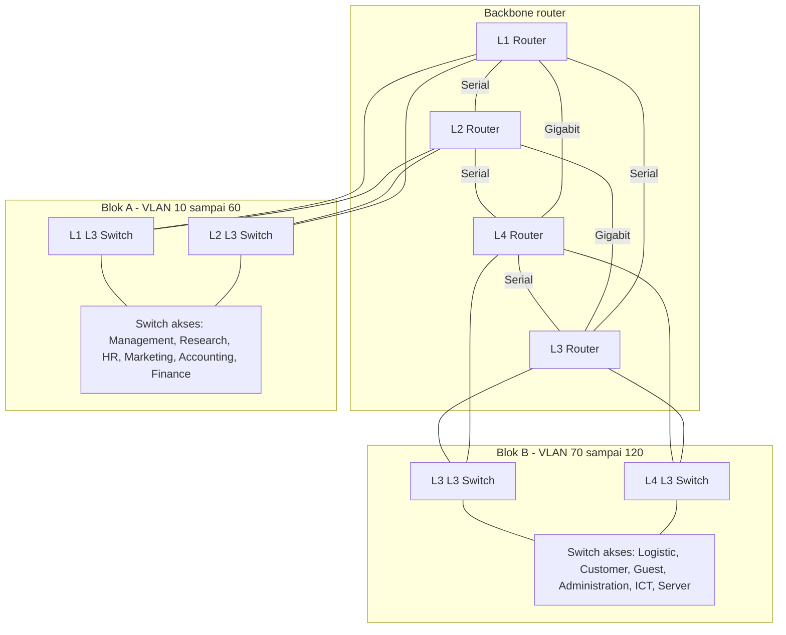

# U-Bank Multi-Site Network – OSPF & Inter-VLAN Routing (Cisco Packet Tracer)

Simulasi jaringan perusahaan (domain `u-bank.local`) dengan **4 router**, **4 multilayer switch**, **12 VLAN** untuk 12 departemen, dan **server DHCP + Web**. Routing memakai **OSPF single area (area 0)**, dan akses antar-VLAN dilakukan di multilayer switch.

- File proyek: `perjar 21 April .pkt`
- Versi Packet Tracer: 8.2.2

## Topologi

Setiap router terhubung ke multilayer switch di sisinya sendiri dan ke switch pasangannya (link silang). Setiap switch akses terhubung ke **dua** multilayer switch (dual-homed), jadi tidak ada single point of failure di jalur distribusi.

## Perangkat

| Jenis | Jumlah | Perangkat |
|---|---|---|
| Router 2911 | 4 | L1_Router, L2_Router, L3_Router, L4_Router |
| Multilayer Switch 3650-24PS | 4 | L1_L3S, L2_L3S, L3_L3S, L4_L3S |
| Switch 2960-24TT | 12 | satu per departemen |
| Server | 2 | DHCP, Web |
| End device | 11 PC, 1 Laptop (wireless via Access Point di VLAN Guest) | |

## VLAN & Subnet

Semua subnet memakai `/26` (255.255.255.192). Gateway berada di SVI multilayer switch dan `ip helper-address` mengarah ke server DHCP (`192.168.12.194`).

| Blok | VLAN | Nama | Subnet | Gateway |
|---|---|---|---|---|
| A (L1 dan L2) | 10 | Management | 192.168.10.0/26 | 192.168.10.1 |
| A | 20 | Research | 192.168.10.64/26 | 192.168.10.65 |
| A | 30 | HR | 192.168.10.128/26 | 192.168.10.129 |
| A | 40 | Marketing | 192.168.10.192/26 | 192.168.10.193 |
| A | 50 | Accounting | 192.168.11.0/26 | 192.168.11.1 |
| A | 60 | Finance | 192.168.11.64/26 | 192.168.11.65 |
| B (L3 dan L4) | 70 | Logistic | 192.168.11.128/26 | 192.168.11.129 |
| B | 80 | Customer | 192.168.11.192/26 | 192.168.11.193 |
| B | 90 | Guest | 192.168.12.0/26 | 192.168.12.1 |
| B | 100 | Administration | 192.168.12.64/26 | 192.168.12.65 |
| B | 110 | ICT | 192.168.12.128/26 | 192.168.12.129 |
| B | 120 | Server | 192.168.12.192/26 | 192.168.12.193 |

### Server (VLAN 120)

| Server | IP |
|---|---|
| DHCP | 192.168.12.194 |
| Web | 192.168.12.195 |

Server DHCP memiliki pool untuk VLAN 10–110 (VLAN Server memakai IP statis). PC mendapat alamat otomatis dari DHCP.

## Link Antar Perangkat (10.10.10.0/24, /30)

### Backbone router

| Link | Subnet | Sisi A | Sisi B |
|---|---|---|---|
| L1 – L2 (serial) | 10.10.10.0/30 | L1 Se0/3/0 `.1` | L2 Se0/3/0 `.2` |
| L1 – L4 (gigabit) | 10.10.10.8/30 | L1 Gi0/0 `.9` | L4 Gi0/0 `.10` |
| L2 – L4 (serial) | 10.10.10.12/30 | L2 Se0/3/1 `.13` | L4 Se0/3/0 `.14` |
| L2 – L3 (gigabit) | 10.10.10.16/30 | L2 Gi0/0 `.17` | L3 Gi0/0 `.18` |
| L1 – L3 (serial) | 10.10.10.4/30 | L1 Se0/3/1 `.5` | L3 Se0/3/0 `.6` |
| L3 – L4 (serial) | 10.10.10.20/30 | L3 Se0/3/1 `.21` | L4 Se0/3/1 `.22` |

Dua baris terakhir adalah rencana pengalamatan di konfigurasi. Lihat catatan nomor 1 untuk kondisi kabelnya.

### Router ke multilayer switch

| Link | Subnet | Router | L3 Switch |
|---|---|---|---|
| L1 | 10.10.10.24/30 | L1 Gi0/1 `.25` | L1_L3S Gi1/0/1 `.26` |
| L2 | 10.10.10.28/30 | L2 Gi0/1 `.29` | L2_L3S Gi1/0/1 `.30` |
| L3 | 10.10.10.32/30 | L3 Gi0/1 `.33` | L3_L3S Gi1/0/1 `.34` |
| L4 | 10.10.10.36/30 | L4 Gi0/1 `.37` | L4_L3S Gi1/0/1 `.38` |

Link silang (Gi0/2 router ke Gi1/0/2 switch pasangan) memakai subnet `10.10.10.40/30` (L1/L2) dan `10.10.10.44/30` (L3/L4).

## Konfigurasi

### OSPF (process 1, area 0)

| Perangkat | Router ID |
|---|---|
| L1_Router | 1.1.1.1 |
| L2_Router | 2.2.2.2 |
| L3_Router | 3.3.3.3 |
| L4_Router | 4.4.4.4 |
| L2_L3S | 22.22.22.22 |
| L3_L3S | 33.33.33.33 |
| L4_L3S | 44.44.44.44 |

L1_L3S tidak mengatur router-id manual (dipilih otomatis).

### Layer 2

- Port multilayer switch ke switch akses: **trunk**.
- Port ke PC, server, dan AP: **access** sesuai VLAN.
- Access Point (VLAN Guest) terhubung ke `L3_SGuest` Fa0/4.
- Server DHCP dan Web terhubung ke `L4_SServer` Fa0/3 dan Fa0/4.

### Keamanan

- Remote access hanya **SSH v2** (`transport input ssh`, login lokal, domain `u-bank.local`) di router.
- `service password-encryption` aktif dan banner *Authorized SSH access only*.

## Cara Menggunakan

1. Buka `perjar 21 April .pkt` dengan Cisco Packet Tracer 8.2.2 atau lebih baru.
2. Tunggu OSPF konvergen dan DHCP memberi alamat ke PC.
3. Uji konektivitas: `ping` antar-VLAN (misalnya dari PC Management ke PC ICT), ke server DHCP/Web, dan akses web server `192.168.12.195` dari browser PC.
